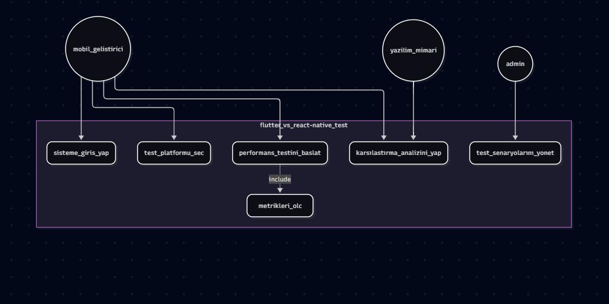
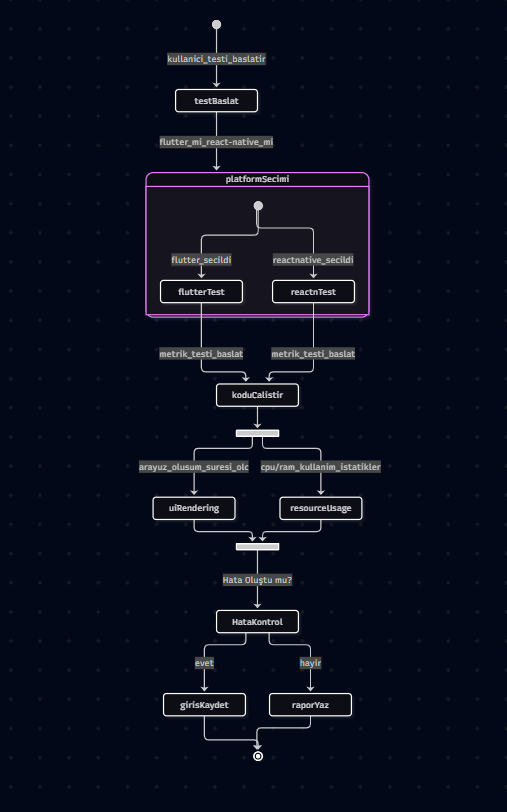
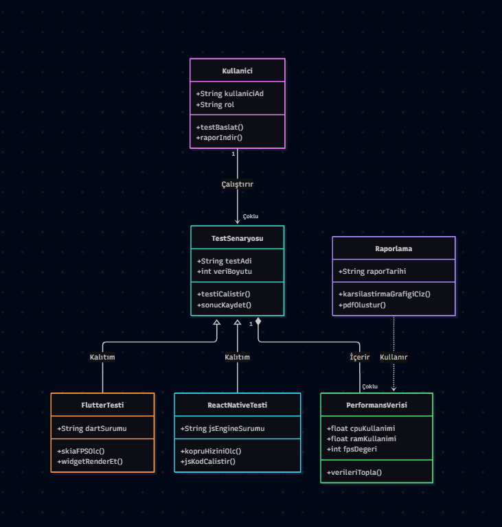

1. Use Case Diagram

-Sistemdeki temel aktörler (mobil_gelistirici,yazilim_mimari,admin) ve gerçekleştirebildikleri işlemler gösterilmiştir. 
-Performans testi başlatıldığında arka planda metrikleri_olc kullanımı include ilişkisiyle zorunlu olarak tetiklenmektedir.
---
2. Activity Diagram

-Test platformunun iş süreci akışını temsil eder. 
-Kullanıcı Flutter veya React Native ortamını seçtikten sonra paralel akış ile FPS,CPU,RAM eşzamanlı olarak ölçülmektedir. Hata durumunda log kaydedilerek süreç güvenli şekilde sonlandırılmaktadır.
---
3. Class Diagram

-Sistemin nesne yönelimli yapısını modeller. 
-TestSenaryosu ana sınıfından FlutterTesti ve ReactnativeTesti sınıfları kalıtım yoluyla üretilmiştir.
